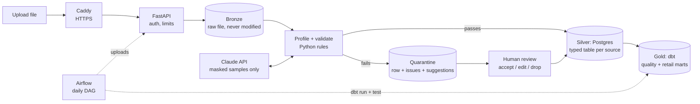
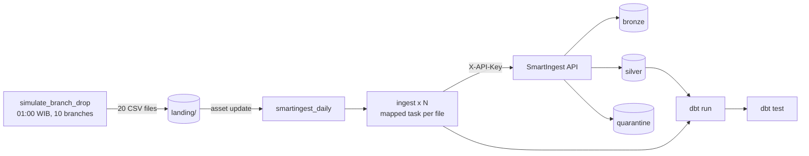

# SmartIngest

[](https://github.com/Bovendiska/smartingest/actions/workflows/ci.yml)

**Upload a messy Excel / CSV / JSON file, get a clean typed table.** SmartIngest infers each column's meaning, auto-fixes what is safe to fix, quarantines what is not, and asks Claude for suggestions on the hard cases. A human approves every non-trivial change.

Inspired by Trifacta / Google Cloud Dataprep (suggested transformations), Great Expectations (data contracts) and Monte Carlo (data observability).

```
Mail column, 5 rows:        SmartIngest says:
budi@gmail.com              ok
siti@gmial.com              typo domain      -> siti@gmail.com       (high, auto-fixed)
 Agus@OUTLOOK.com           case/whitespace  -> agus@outlook.com     (high, auto-fixed)
reindra@                    missing domain   -> reindra@gmail.com    (low, needs review)
dewi.yahoo.com              missing '@'      -> dewi@yahoo.com       (medium, needs review)
```

## Architecture



Key design decisions:

| Decision | Why |
| --- | --- |
| Everything is read as text first | Type inference is our job; leading zeros in phone numbers survive |
| Loose detectors for inference, strict ones for validation | `reindra@` is evidence that a column holds emails, even though it is not a valid email |
| Only `high` confidence fixes are auto-applied | Lossless normalisation only (trim, case, formats). Guesses always go to a human |
| LLM suggestions are capped at `medium` | The model never changes data on its own |
| PII is masked before any API call | `Reindra@gmial.com` is sent as `Aaaaaaa@gmial.com`; amounts and flags are sent as-is |
| `batch_id = uuid5(owner, source, sha256(file))` | Re-uploading the same file is a no-op (idempotent) |
| Column names are slugified to `[a-z0-9_]`, SQL uses `psycopg.sql.Identifier` | Headers are user input; no SQL injection through a column name |
| Schema registry per source | A later file whose column changes type is rejected with HTTP 409 (schema drift) instead of silently corrupting the table |

## Security model (public demo)

Anyone can try SmartIngest, so the service assumes every upload and every visitor may be hostile.

| Threat | Control |
| --- | --- |
| Visitors seeing each other's data | Anonymous demo sessions; each visitor gets isolated `silver.demo_<id>_*` tables and only sees their own batches (other ids return 404) |
| Real personal data in a demo upload | Visible notice to upload dummy data only; demo data is deleted automatically after 24 h; values sent to Claude are always masked for visitors |
| Malicious files | Extension allow-list, content checked against the extension, zip-bomb guard for `.xlsx`, size / row / column / cell-length limits, uploaded filename never used |
| Abuse and cost | Per-IP rate limit, demo sessions per IP per hour, upload quota per session, daily cap on Claude calls, per-upload cap on values sent to Claude |
| Prompt injection through cell values | Values truncated, output must match a schema, rows outside the request are ignored, LLM output is never auto-applied |
| Stolen database | Demo tokens stored as SHA-256 hashes; visitor IPs stored hashed |
| Database takeover | Postgres has no published port; the API connects as a least-privilege role that cannot touch `public` or alter `meta` |
| Leaking internals | Generic 500 responses with an error id; details only in server logs |
| Weak configuration | The API refuses to start with default or short secrets |
| Traffic sniffing | Caddy terminates HTTPS with automatic certificates and sets HSTS and security headers |

## Results (rule-only baseline)

Synthetic dataset: 2,020 customer rows, 7 columns, 1,113 injected errors across 18 error types (`scripts/generate_dirty_data.py --rows 2000 --seed 42`).

| Metric | Rule-only | Rule + Claude |
| --- | --- | --- |
| Detection recall | 100.0% | _run with `--llm`_ |
| Detection precision | 100.0% | |
| Suggestion coverage | 84.3% | |
| Fix accuracy (suggestion == original clean value) | 99.2% | |
| Auto-fix error rate | 0.00% (769 auto-fixed) | |
| Rows quarantined for review | 324 of 2,020 | |

What rules cannot fix, and where Claude is expected to add value: amounts written in words (`seratus ribu`, 49 cases), and email domains that can only be guessed (8 of 27 guesses wrong). Impossible dates and truncated phone numbers have no recoverable answer; those stay with a human.

> Caveat worth stating in interviews: the generator and the rules were written by the same person, so the rule-only numbers are an upper bound. The next step is a held-out set of error types the rules were not designed for, plus a sample of real-world dirty data.

## Daily pipeline (Airflow + dbt)

To show the medallion layers working every day, a fictional retailer, **RetailKu**, has 10 branches that each send two messy CSV files every night (`customers.csv`, `transactions.csv`). Two DAGs run the flow:



| Layer | Where | What is in it |
| --- | --- | --- |
| Bronze | `bronze` volume | Every file exactly as it arrived |
| Silver | `silver.retailku_*` | Validated, typed rows; rows needing review wait in `quarantine.rows` |
| Staging | `staging.*` (dbt views) | Renamed columns, record-level de-duplication, contact data reduced to flags |
| Gold | `gold.*` (dbt tables) | `quality_by_source`, `issues_by_rule`, `sales_by_branch_month`, `customer_summary` |

Design choices worth defending:

- **Two levels of idempotency.** A re-sent file has the same `batch_id`, so SmartIngest answers 200 and loads nothing (file level). A sale exported again in the next day's file has the same `transaction_id`, so staging keeps the first copy (record level).
- **Files move only after SmartIngest answers.** Accepted files go to `landing/_archive/`, files refused for schema drift (409) or as unreadable (422) go to `landing/_rejected/` with the reason. A crash in between just means the next run uploads the same bytes and gets 200.
- **Gold never hides the backlog.** `sales_by_branch_month.rows_pending_review` sits next to revenue, so "not reviewed yet" is not mistaken for "no sales". A dbt test that warns on sales pointing at members still in quarantine makes the same point.
- **Least privilege everywhere.** dbt connects as `smartingest_dbt`: read-only on silver and on the meta tables it needs, owner of `staging` and `gold` only. Airflow has its own database. A dbt test fails the run if any email or phone column ever reaches the gold schema.
- **Secrets stay out of code and logs.** The API key reaches the DAG as an Airflow connection (masked in task logs); the dbt password is a `DBT_ENV_SECRET_` variable (scrubbed from dbt logs). The Airflow UI listens on `127.0.0.1` only.

Simulated data: about 10 new members and 40 sales per branch per day (more on weekends and around payday), with roughly 6% of customer cells and 3% of transaction cells corrupted. Generate files without Airflow: `python dags/retailku/simulator.py --start 2026-10-01 --days 7 --out landing`.

## Quick start

### 1. Pipeline only (no Docker, no database)

```bash
pip install pandas openpyxl pydantic
python scripts/generate_dirty_data.py --rows 2000 --out examples
python scripts/run_local.py examples/customers_dirty.xlsx --out output
python scripts/evaluate.py                                   # rule-only metrics
ANTHROPIC_API_KEY=sk-... python scripts/evaluate.py --llm    # rule + Claude
```

### 2. Full stack on your laptop

```bash
cp .env.example .env    # replace every change-me (openssl rand -hex 32); keep DOMAIN=:80
docker compose up --build
```

Open http://localhost/docs (API) and http://localhost:8080 (Airflow, log in with `AIRFLOW_ADMIN_USER` / `AIRFLOW_ADMIN_PASSWORD`). In Airflow, unpause both DAGs, then trigger `simulate_branch_drop`; `smartingest_daily` starts by itself when the files land. To backfill, trigger the producer again with a `business_date`. Start with about three weeks of history, because sales refer to members registered up to 21 days earlier.

As a demo visitor:

```bash
# A demo visitor
TOKEN=$(curl -s -X POST http://localhost/demo/sessions | python -c "import sys,json;print(json.load(sys.stdin)['token'])")
curl -H "X-Demo-Token: $TOKEN" -F "file=@examples/customers_dirty.csv" http://localhost/sources/customers/uploads
curl -H "X-Demo-Token: $TOKEN" "http://localhost/batches/<batch_id>/issues"
curl -H "X-Demo-Token: $TOKEN" -X POST http://localhost/issues/42/resolve \
     -H "Content-Type: application/json" -d '{"action": "edit", "value": "reindra@outlook.com"}'

# You, the owner: same endpoints with -H "X-API-Key: $ADMIN_API_KEY" (bigger limits, sees everything)
```

When the last open issue of a row is resolved, the row moves from `quarantine.rows` into its silver table.

### 3. Production

Point a domain at your VPS, set `DOMAIN=your.domain` in `.env`, and run `docker compose up -d --build`. Caddy obtains the HTTPS certificate. Reach Airflow through an SSH tunnel (`ssh -L 8080:localhost:8080 you@your-vps`), never by opening port 8080. Schedule `deploy/backup.sh` daily with cron and copy the `backups/` folder off the server.

### Tests

```bash
pip install -r requirements-dev.txt
pytest -q && ruff check .
```

## Project layout

```
src/smartingest/
  parsing.py      read CSV / Excel / JSON as text, slugify headers
  detectors.py    loose + strict value detectors, column-name hints
  profiler.py     semantic type inference per column
  validators.py   fixers with confidence levels
  masking.py      PII masking before LLM calls
  llm.py          Claude advisor: column classification + fix suggestions
  pipeline.py     orchestrates the above (pure, no I/O)
  security.py     upload checks, tokens, rate limiting
  bronze.py       raw files on a local volume or any S3-compatible service
  storage.py      Postgres: meta, silver, quarantine, demo sessions
  api.py          FastAPI endpoints, access control
dags/
  simulate_branch_drop.py   producer: RetailKu's nightly file drops
  smartingest_daily.py      consumer: ingest via the API, then dbt run + dbt test
  retailku/                 plain-Python simulator and landing-zone logic (unit-tested)
dbt/                staging + gold models, schema and singular tests
airflow/Dockerfile  Airflow 3.3 with dbt in its own virtualenv
deploy/           Caddyfile, backup and restore scripts
scripts/          data generator, evaluator, local runner
sql/              schema, least-privilege app role, dbt role + Airflow database
```

## Roadmap

1. **Foundation + validation:** parsing, inference, rules, quarantine, API, eval harness
2. **Orchestration** (this commit): Airflow 3 producer/consumer DAGs, dbt gold layer with quality and retail marts
3. **Claude integration:** column classification, fix suggestions, AI-generated data contracts, cost tracking in `meta.llm_calls`
4. **Eval + dashboard:** rule-only vs rule + Claude table, Metabase quality and cost dashboard
5. **Polish + deploy:** VPS with HTTPS, demo video, optional Hermes Agent Telegram notifications for ops